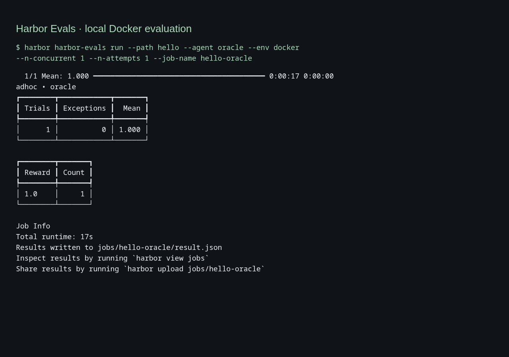

### [Harbor Evals (Harbor Framework)](https://github.com/harbor-framework/harbor)

> Handle: `harbor-evals`<br/>
> Interface: CLI, no published port

[Harbor Framework](https://docs.harborframework.com/) is the agent evaluation framework from the creators of Terminal-Bench. Its former `laude-institute/harbor` repository redirects to `harbor-framework/harbor`. It runs tasks, agents and verifiers in container environments, including local Docker.



The service handle is **`harbor-evals`** everywhere in this toolkit. The upstream package and the binary inside the container stay **`harbor`**. On the host, `harbor harbor-evals ...` forwards arguments to that binary. This keeps upstream command examples recognizable without installing a second host command named `harbor`. Harbor's existing `eval` command continues to run Promptfoo.

## Starting

This service uses your local Docker daemon. On Linux, give the runner the socket's group ID:

```bash
harbor config set HARBOR_HARBOR_EVALS_DOCKER_GID "$(stat -c %g /var/run/docker.sock)"
```

For a socket owned by group ID `0`, keep the default. The socket must be available at `/var/run/docker.sock`.

Create the workspace as your host user before starting:

```bash
mkdir -p "$(harbor home)/services/harbor-evals/data"
harbor build harbor-evals
harbor up harbor-evals
harbor harbor-evals --help
harbor harbor-evals run --help
harbor harbor-evals --version
```

`up` keeps an idle runner available for `harbor exec` and `harbor shell`. Each `harbor harbor-evals` invocation runs a temporary container with the same workspace and removes it on exit. It also works without starting the idle runner first. There is no web server or `--open` action.

## Usage

### Tiny free local evaluation

The included task asks an agent to write a greeting. The upstream `oracle` agent executes the included solution and the verifier checks the resulting file. This validates task setup, execution, verification and result persistence. It measures harness operation, not model quality. It uses no model, API key or cloud provider.

```bash
cp -R "$(harbor home)/services/harbor-evals/example" \
  "$(harbor home)/services/harbor-evals/data/hello"
harbor harbor-evals run --path hello --agent oracle --env docker \
  --n-concurrent 1 --n-attempts 1 --job-name hello-oracle
```

Expect one completed trial, zero errors and reward `1.0`. Results, verifier logs and the job configuration appear under `services/harbor-evals/data/jobs/hello-oracle/`. Use a fresh job name for each run. With a custom workspace, copy the task there instead.

To evaluate a model, replace `oracle` with an upstream agent and supply that agent's model and endpoint settings. Credentials can be configured in `harbor env harbor-evals`; they are passed to the runner. Agent-specific options and environment forwarding are documented by `harbor harbor-evals run --help`. Paid providers are optional.

### Translating upstream commands

```bash
# Upstream: harbor datasets list
harbor harbor-evals datasets list

# Inside the runner, the original executable is available:
harbor exec harbor-evals harbor --help
```

Keep local tasks, configs and results inside the mounted workspace. Absolute paths outside it exist only on the host unless separately mounted. Dataset downloads and job outputs use the workspace by default. Tasks create separate Docker containers and networks, so these do not automatically join the toolkit's `harbor-network` or inherit its backend service names.

## Configuration

### Environment Variables

Set these with [`harbor config`](./3.-Harbor-CLI-Reference.md#harbor-config):

| Variable | Default | Purpose |
| --- | --- | --- |
| `HARBOR_HARBOR_EVALS_VERSION` | `0.24.0` | Upstream PyPI package version. Rebuild after changing it. |
| `HARBOR_HARBOR_EVALS_WORKSPACE` | `${HARBOR_HOME_VOLUME}/services/harbor-evals/data` | Absolute workspace path, identical on host and runner. Create it as your host user. |
| `HARBOR_HARBOR_EVALS_DOCKER_GID` | `0` | Supplementary group for access to the host Docker socket. |

For example:

```bash
harbor config set HARBOR_HARBOR_EVALS_WORKSPACE /absolute/path/to/evals
mkdir -p /absolute/path/to/evals
harbor up harbor-evals
```

The runner uses Harbor's host user and group IDs. Its home is the workspace, so tasks, results, downloaded datasets and the upstream cache persist there. Upstream telemetry is disabled with `HARBOR_TELEMETRY=0`.

### Volumes

- The workspace is mounted at **the same absolute path** in the runner and on the host. The upstream harness asks the host daemon to bind job log directories into task containers, so translating it to `/app` would break verification and results.
- `/var/run/docker.sock` grants control over the host Docker daemon. Only run trusted tasks and agents on a host whose Docker access you intend to grant.
- The workspace uses a shared SELinux label (`:z`). The runner disables its own SELinux label isolation to access the Docker socket on Fedora. Upstream task log mounts also use shared labels.
- The build installs Git, Python, Docker CLI, Docker Compose and the pinned `harbor` package. No privileged Docker-in-Docker daemon or paid sandbox is required.

## Troubleshooting

- **Socket permission denied:** set `HARBOR_HARBOR_EVALS_DOCKER_GID` using the Linux command above, then recreate the runner with `harbor up harbor-evals`.
- **Workspace permission denied:** create the workspace as your host user before the first run. If Docker already created a root-owned directory, correct its ownership before retrying.
- **Missing reward or empty result directories:** ensure the workspace is an absolute path and matches on both sides of the mount. Do not put results outside it.
- **Docker unavailable:** Docker Engine or Docker Desktop must be running, with its socket exposed at `/var/run/docker.sock`.
- **Duplicate job name:** choose another `--job-name` rather than overwriting an existing run.

```bash
harbor logs harbor-evals --no-follow
harbor down harbor-evals
```

The idle runner has no application logs. Evaluation output appears in the invoking terminal and workspace job logs. Stopping the runner retains jobs and task inputs. Interrupted evaluations may leave upstream task containers for inspection or cleanup.

## Links

- [Harbor Framework repository](https://github.com/harbor-framework/harbor)
- [Official documentation](https://docs.harborframework.com/)
- [Terminal-Bench](https://www.tbench.ai/)
