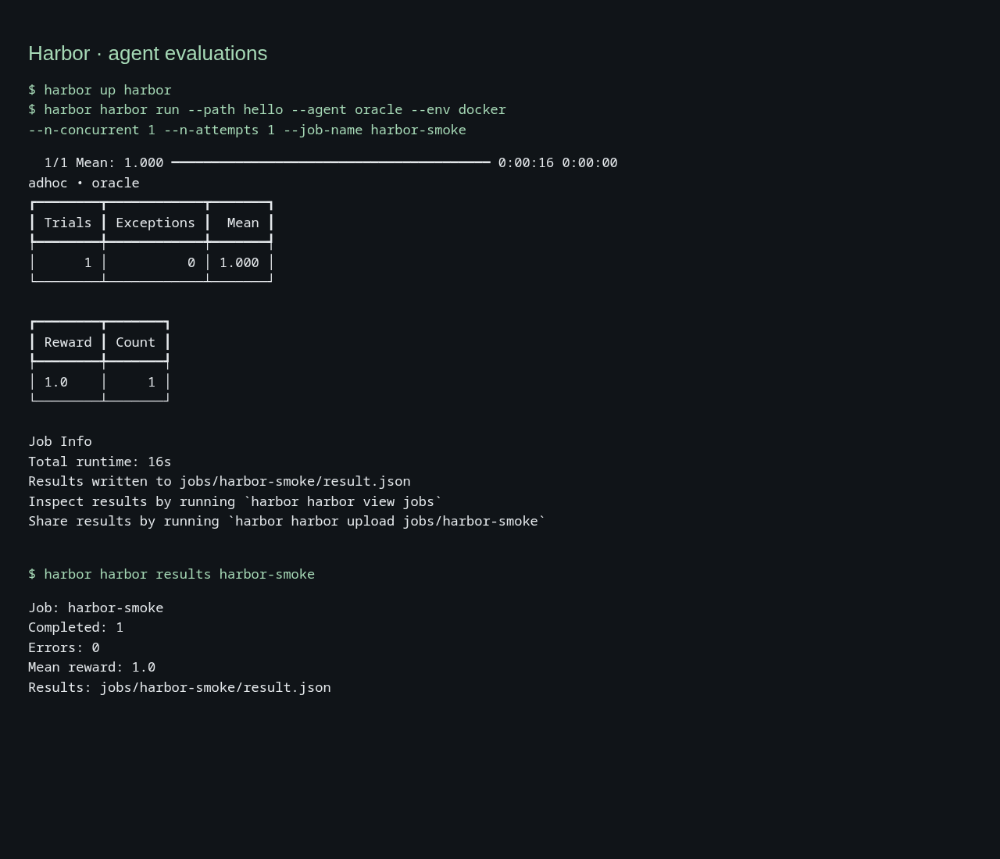

### [Harbor (Agent Evaluations)](https://github.com/harbor-framework/harbor)

> Handle: `harbor`<br/>
> Interface: CLI, no published port

[Harbor Framework](https://docs.harborframework.com/) is Laude Institute's agent evaluation framework from the creators of Terminal-Bench. It runs tasks, agents and verifiers in container environments, including local Docker. Its former `laude-institute/harbor` repository redirects to `harbor-framework/harbor`.



The service is named `harbor`. The first `harbor` in these commands is the toolkit. The second selects the evaluation framework:

```bash
harbor up harbor
harbor harbor --help
harbor harbor run --path hello --agent oracle --job-name smoke
harbor harbor results smoke
```

No extra alias, host framework installation or standalone launcher is needed. Existing named Promptfoo evaluations and the built-in Harbor Bench service are unchanged.

## Starting

This service uses your local Docker daemon through `/var/run/docker.sock`. On Linux, configure its socket group:

```bash
harbor config set HARBOR_HARBOR_DOCKER_GID "$(stat -c %g /var/run/docker.sock)"
```

For a socket owned by group ID `0`, keep the default. Create the workspace as your host user, build and start:

```bash
mkdir -p "$(harbor home)/services/harbor/data"
harbor build harbor
harbor up harbor
harbor harbor --help
harbor harbor run --help
harbor harbor --version
```

`up` keeps an idle runner available for `harbor exec harbor` and `harbor shell harbor`. Each `harbor harbor` invocation runs a temporary container with the same workspace and removes it on exit. It also works without starting the idle runner first. There is no published web server or `--open` action.

## Usage

### Tiny free local evaluation

The included task asks an agent to write a greeting. The upstream `oracle` agent executes the bundled solution and the verifier checks the resulting file. This validates setup, execution, verification and result persistence. It measures framework operation rather than model quality. It uses no model, API key or cloud provider.

```bash
cp -R "$(harbor home)/services/harbor/example" \
  "$(harbor home)/services/harbor/data/hello"
harbor harbor run --path hello --agent oracle --env docker \
  --n-concurrent 1 --n-attempts 1 --job-name hello-oracle
harbor harbor results hello-oracle
```

Expect one completed trial, zero errors and reward `1.0`. Results, verifier logs and configuration appear under `services/harbor/data/jobs/hello-oracle/`. Use a fresh job name for each run. With a custom workspace, copy the task there instead.

To evaluate a model, replace `oracle` with an upstream agent and supply that agent's model and endpoint settings. Credentials can be configured in `harbor env harbor`; they are passed to the runner. Agent-specific options and environment forwarding are documented by `harbor harbor run --help`. Paid providers are optional.

### Framework commands

```bash
harbor harbor dataset list
harbor harbor job --help
harbor harbor task --help
```

Keep local tasks, configs and results inside the mounted workspace. Absolute paths outside it exist only on the host unless separately mounted. Dataset downloads and job outputs use the workspace by default. Tasks create separate Docker containers and networks, so these do not automatically join the toolkit's `harbor-network` or inherit backend service names.

### Read saved results

```bash
harbor harbor results hello-oracle
```

`results` reads `jobs/<name>/result.json` from the workspace and prints completed trials, errors and mean reward. A job is a named evaluation run. Reading results makes no model or hosted-service call. An unknown job reports an error and exits with status 2. This small integration command supplements the framework's own subcommands. Help and follow-up hints use `harbor harbor` so they can be pasted into the host shell.

The upstream `view` subcommand starts a server inside the container and needs an explicit port mapping and `--host 0.0.0.0` for browser access. Use `results` for the CLI workflow.

## Configuration

### Environment Variables

Set these with [`harbor config`](./3.-Harbor-CLI-Reference.md#harbor-config):

| Variable | Default | Purpose |
| --- | --- | --- |
| `HARBOR_HARBOR_VERSION` | `0.24.0` | Upstream PyPI package version. Rebuild after changing it. |
| `HARBOR_HARBOR_WORKSPACE` | `${HARBOR_HOME_VOLUME}/services/harbor/data` | Absolute workspace path, identical on host and runner. Create it as your host user. |
| `HARBOR_HARBOR_DOCKER_GID` | `0` | Supplementary group for access to the host Docker socket. |

For example:

```bash
harbor config set HARBOR_HARBOR_WORKSPACE /absolute/path/to/evals
mkdir -p /absolute/path/to/evals
harbor up harbor
```

The runner uses Harbor's host user and group IDs. Its home is the workspace, so tasks, results, downloaded datasets and the upstream cache persist there. Upstream telemetry is disabled with `HARBOR_TELEMETRY=0`.

### Volumes

- The workspace is mounted at the same absolute path in the runner and on the host. The framework asks the host daemon to bind job log directories into task containers, so translating it to `/app` would break verification and results.
- `/var/run/docker.sock` grants control over the host Docker daemon. Only run trusted tasks and agents on a host whose Docker access you intend to grant.
- The workspace uses a shared SELinux label (`:z`). The runner disables its own SELinux label isolation to access the Docker socket on Fedora. Upstream task log mounts also use shared labels.
- The build installs Git, Python, Docker CLI, Docker Compose and the pinned `harbor` package. No privileged Docker-in-Docker daemon or paid sandbox is required.

## Troubleshooting

- **Socket permission denied:** set `HARBOR_HARBOR_DOCKER_GID` using the Linux command above, then recreate the runner with `harbor up harbor`.
- **Workspace permission denied:** create the workspace as your host user before the first run. If Docker already created a root-owned directory, correct its ownership before retrying.
- **Missing reward or empty result directories:** ensure the workspace is an absolute path and matches on both sides of the mount. Keep results inside it.
- **Docker unavailable:** Docker Engine or Docker Desktop must be running, with its socket exposed at `/var/run/docker.sock`.
- **Duplicate job name:** choose another `--job-name` rather than overwriting an existing run.

```bash
harbor logs harbor --no-follow
harbor down harbor
```

The idle runner has no application logs. Evaluation output appears in the invoking terminal and workspace job logs. Stopping the runner retains jobs and task inputs. Interrupted evaluations may leave upstream task containers for inspection or cleanup.

## Links

- [Harbor Framework repository](https://github.com/harbor-framework/harbor)
- [Official documentation](https://docs.harborframework.com/)
- [Terminal-Bench](https://www.tbench.ai/)
