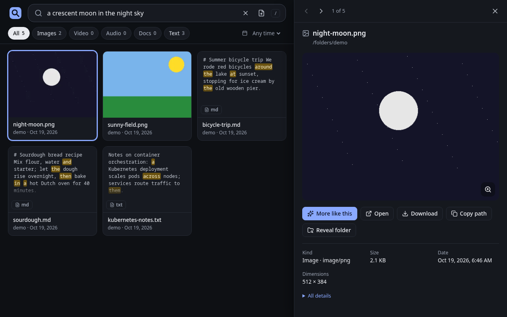

### [rummage](https://github.com/av/rummage)

> Handle: `rummage`<br/>
> URL: [http://localhost:35100](http://localhost:35100)

rummage is local multimodal semantic search for your files. One program serves a web UI and an HTTP API, watches the folders you choose, and indexes text, images, PDFs, audio and video with Google DeepMind's [EmbeddingGemma 2](https://huggingface.co/google/embeddinggemma-2) running on llama.cpp. Search by words, or drop an image, audio or text file on the page to find similar ones.



## Starting

```bash
# Point rummage at the folder you want to search (mounted read-only)
harbor config set rummage.folders ~/Pictures

harbor pull rummage
harbor up rummage --open
```

The host folder from `rummage.folders` is mounted read-only at `/folders`. rummage does not index anything until you add a folder: on first run the web UI opens the folders drawer, where you can browse to `/folders` (or any sub-folder) and add it. The same from the CLI:

```bash
harbor exec rummage rummage folders add /folders
harbor exec rummage rummage status
```

### Private images

The `ghcr.io/av/rummage` images are private while the [av/rummage](https://github.com/av/rummage) repository is private. Log in with a GitHub token that has the `read:packages` scope before pulling:

```bash
docker login ghcr.io -u <github-user>
harbor pull rummage
```

Without access, `harbor pull rummage` and `harbor up rummage` fail with `denied` or `403 Forbidden`.

### Indexing

Indexing runs in the background and follows changes to the files. The EmbeddingGemma 2 model files (about 830 MB at the default `Q8_0`) download into the workspace on the first start; searches answer with a `not_ready` error until the model has loaded.

### GPU

Harbor picks the image to match the detected capability:

| Capability | Image | Devices |
| --- | --- | --- |
| none | `ghcr.io/av/rummage:<version>-cpu` | |
| `nvidia` | `ghcr.io/av/rummage:<version>-cuda` | NVIDIA GPU reservation (needs the NVIDIA Container Toolkit) |
| `rocm` | `ghcr.io/av/rummage:<version>-vulkan` (or `-rocm`) | `/dev/kfd`, `/dev/dri` |

On AMD the Vulkan build is the default because it measured faster than ROCm for EmbeddingGemma 2 on a Radeon 8060S. Switch to the ROCm build with:

```bash
harbor config set rummage.amd_backend rocm
harbor restart rummage
```

The container runs as your host user, so it needs access to `/dev/dri/renderD*`. If those device nodes are not world-accessible on your system (`ls -l /dev/dri`) and `harbor exec rummage rummage doctor` finds no GPU, give the container the host's `render` group:

```bash
harbor config set rummage.gpu_group $(getent group render | cut -d: -f3)
```

Every GPU build falls back to the CPU, with a warning, when it finds no GPU. `harbor exec rummage rummage doctor` shows the backend, GPUs, model files and ffmpeg it found.

## Configuration

### Environment Variables

Following options can be set via [`harbor config`](./3.-Harbor-CLI-Reference.md#harbor-config):

```bash
# Host port for the web UI and the API
HARBOR_RUMMAGE_HOST_PORT=35100

# Image repository and version; the tag is <version>-<backend>
HARBOR_RUMMAGE_IMAGE="ghcr.io/av/rummage"
HARBOR_RUMMAGE_VERSION="latest"

# Holds data/: config, index, thumbnails and model files (mounted at /data)
HARBOR_RUMMAGE_WORKSPACE="./services/rummage"

# Host folder mounted read-only at /folders, for rummage to index
HARBOR_RUMMAGE_FOLDERS="./services/rummage/folders"

# Image used with the rocm capability: "vulkan" or "rocm"
HARBOR_RUMMAGE_AMD_BACKEND="vulkan"

# Container group for GPU device access with the rocm capability:
# a group name from the image or a numeric host gid
HARBOR_RUMMAGE_GPU_GROUP="video"
```

rummage's own settings (model quant, vector size, thumbnail size, skipped directories and so on) are in the web UI settings and in `/data/config/rummage/config.toml`, or can be overridden with `RUMMAGE_*` environment variables through [`harbor env`](./3.-Harbor-CLI-Reference.md#harbor-env), for example:

```bash
# Require a bearer token for the API and the UI
harbor env rummage RUMMAGE_AUTH_TOKEN <long-random-token>
# Use smaller vectors
harbor env rummage RUMMAGE_DIM 256
```

Setting `RUMMAGE_FOLDERS` this way fixes the folder list to that variable and disables adding folders from the UI. See the [config reference](https://github.com/av/rummage#config-reference) for every key.

rummage serves the files it has indexed (previews, downloads) to anyone who can reach its port. Set `RUMMAGE_AUTH_TOKEN` before exposing it beyond your machine.

### Volumes

- `${HARBOR_RUMMAGE_WORKSPACE}/data` at `/data`: config, the index (`rummage.db`), thumbnails, previews and model files. A `rummage-init` container creates it owned by your host user before rummage starts, and rummage runs as your host user.
- `${HARBOR_RUMMAGE_FOLDERS}` at `/folders`, read-only: the files to index. To search several unrelated folders, point it at a common parent and add the sub-folders you want.

## API

Everything the UI does goes through `/api/v1`; the OpenAPI page is at [http://localhost:35100/api/docs](http://localhost:35100/api/docs).

```bash
curl -s -X POST http://localhost:35100/api/v1/search \
  -H 'content-type: application/json' \
  -d '{"query": "red bicycle by a lake", "limit": 5}'
```

## Troubleshooting

```bash
harbor logs rummage
harbor exec rummage rummage doctor
harbor exec rummage rummage status --errors
```

- No results: check that a folder is added (`rummage folders ls`) and that indexing finished (`rummage status`).
- `harbor pull rummage` fails with `403 Forbidden`: the images are private for now, see [Private images](#private-images).
- Running on the CPU on an AMD or NVIDIA machine: check `harbor exec rummage rummage doctor`, and see [GPU](#gpu) for the device group.

## Links

- [GitHub Repository](https://github.com/av/rummage)
- [EmbeddingGemma 2](https://huggingface.co/google/embeddinggemma-2)
